 

### [🚀 Começar o curso](modulos/00-introducao/README.md)

[Módulos](#-módulos) · [Quizzes e jogos](#-quizzes-e-jogos) · [Cheatsheet](materiais/cheatsheet.md) · [Glossário](materiais/glossario.md) · [Erros comuns](materiais/erros-comuns.md)

---

## 👋 Nunca usaste Git? Estás no sítio certo

Este é um curso prático de **Git** e **GitHub** em português, pensado para quem nunca programou nem abriu um terminal. Começamos na criação da conta e na instalação, e terminamos a colaborar em projetos com branches e pull requests.

Não precisas de saber programar. Só precisas de um computador e de vontade de escrever comandos.

<table>
<tr>
<td width="33%" align="center" valign="top">

### 🌱

**Para quem está a começar**

Nunca usaste Git e queres aprender desde o primeiro passo.

</td>
<td width="33%" align="center" valign="top">

### 🤔

**Para quem usa "de cor"**

Já fazes `add`, `commit` e `push`, mas não percebes o que está a acontecer.

</td>
<td width="33%" align="center" valign="top">

### 🤝

**Para quem vai trabalhar em equipa**

Queres rever os fundamentos antes de abrir o teu primeiro pull request.

</td>
</tr>
</table>

## ✨ O que vais conseguir fazer

 

No fim do curso, estes três comandos deixam de ser uma receita e passam a fazer sentido. Vais saber:

- 📸 **Guardar versões** do teu trabalho e voltar atrás quando algo corre mal.
- 🌿 **Trabalhar em paralelo** com branches, sem estragar o que já funciona.
- ☁️ **Publicar no GitHub** e construir um perfil que serve de portefólio.
- 🤝 **Colaborar** com outras pessoas através de pull requests e revisão de código.

## 🗺️ O percurso

## 📚 Módulos

Segue-os por ordem. Cada um parte do que foi feito no anterior.

### 🔵 Fase 1 · Primeiros passos

| # | Módulo | O que vais aprender | Duração |
|---|--------|---------------------|---------|
| 00 | [Introdução](modulos/00-introducao/README.md) | O que é controlo de versões, Git vs GitHub | 30 min |
| 01 | [Preparar o ambiente](modulos/01-preparar-ambiente/README.md) | Conta GitHub, instalar e configurar o Git, VS Code | 1 h |
| 02 | [Terminal básico](modulos/02-terminal-basico/README.md) | Navegar em pastas e criar ficheiros pela linha de comandos | 1 h |

### 🟣 Fase 2 · Git no teu computador

| # | Módulo | O que vais aprender | Duração |
|---|--------|---------------------|---------|
| 03 | [Primeiro repositório](modulos/03-primeiro-repositorio/README.md) | `init`, `status`, `add`, `commit`, `log` | 1h30 |
| 04 | [Histórico e desfazer](modulos/04-historico-e-desfazer/README.md) | `diff`, `restore`, `reset`, `revert`, `.gitignore` | 1h30 |
| 05 | [Branches e merge](modulos/05-branches-e-merge/README.md) | Criar branches, juntar trabalho, resolver conflitos | 2 h |

### 🟢 Fase 3 · GitHub

| # | Módulo | O que vais aprender | Duração |
|---|--------|---------------------|---------|
| 06 | [GitHub e repositórios remotos](modulos/06-github-remotos/README.md) | `remote`, `push`, `pull`, `clone`, autenticação | 1h30 |
| 07 | [Colaboração](modulos/07-colaboracao/README.md) | Fork, pull request, issues, revisão de código | 2 h |

### 🟠 Fase 4 · Nível profissional

| # | Módulo | O que vais aprender | Duração |
|---|--------|---------------------|---------|
| 08 | [Boas práticas](modulos/08-boas-praticas/README.md) | Mensagens de commit, README, Markdown, licenças | 1h30 |
| 09 | [Ferramentas avançadas](modulos/09-ferramentas-avancadas/README.md) | `stash`, `rebase`, `cherry-pick`, tags, `reflog` | 2 h |
| 10 | [Projeto final](modulos/10-projeto-final/README.md) | Um projeto completo, do `init` ao pull request | 3 h |

## 🧭 Como estudar

<table>
<tr>
<td width="25%" align="center" valign="top">

### 1️⃣

**Lê o módulo**

Por ordem, sem saltar. Cada um demora entre 30 minutos e 3 horas.

</td>
<td width="25%" align="center" valign="top">

### 2️⃣

**Escreve os comandos**

À mão, sem copiar e colar. É assim que ficam na memória.

</td>
<td width="25%" align="center" valign="top">

### 3️⃣

**Faz os exercícios**

Todos os módulos terminam com exercícios e um quiz.

</td>
<td width="25%" align="center" valign="top">

### 4️⃣

**Joga**

Repete o que aprendeste num jogo, até sair sem pensar.

</td>
</tr>
</table>

> [!TIP]
> Quando algo correr mal (vai correr), consulta os [erros comuns](materiais/erros-comuns.md). Errar faz parte.

## 🎮 Quizzes e jogos

**Quizzes.** Cada módulo de 00 a 09 termina com um quiz de escolha múltipla. As respostas estão escondidas: responde primeiro, abre depois.

[00](modulos/00-introducao/quiz.md) · [01](modulos/01-preparar-ambiente/quiz.md) · [02](modulos/02-terminal-basico/quiz.md) · [03](modulos/03-primeiro-repositorio/quiz.md) · [04](modulos/04-historico-e-desfazer/quiz.md) · [05](modulos/05-branches-e-merge/quiz.md) · [06](modulos/06-github-remotos/quiz.md) · [07](modulos/07-colaboracao/quiz.md) · [08](modulos/08-boas-praticas/quiz.md) · [09](modulos/09-ferramentas-avancadas/quiz.md)

**Desafio Learn Git Branching.** Os 36 níveis do jogo [Learn Git Branching](https://learngitbranching.js.org/?locale=pt_BR), organizados em seis etapas que acompanham os módulos, com metas 🥉 Bronze, 🥈 Prata e 🥇 Ouro. [Ver o roteiro do desafio](desafios/learn-git-branching.md).

**Mais jogos.** Há jogos para os outros módulos, do terminal ao Markdown. A página [Jogos e prática interativa](desafios/README.md) diz qual jogar em cada módulo e traz exercícios para cada um.

## 🧰 Materiais de apoio

| | Material | Para que serve |
|---|----------|----------------|
| ⚡ | [Cheatsheet de comandos](materiais/cheatsheet.md) | Os comandos mais usados numa página |
| 📖 | [Glossário](materiais/glossario.md) | Os termos em inglês explicados em português |
| 🚑 | [Erros comuns](materiais/erros-comuns.md) | Mensagens de erro frequentes e como resolver |
| 🔗 | [Referências](REFERENCIAS.md) | Livros, vídeos, jogos e documentação em português e em inglês |

## 🛤️ A trilha completa

Este curso é o primeiro passo de uma trilha maior:

1. **Git e GitHub do zero** (este repositório)
2. Python do zero ao avançado *(em breve)*
3. Automação com Python: relatórios, bots e integrações *(em breve)*

Aprender Git primeiro tem uma razão simples: tudo o que escreveres nas próximas etapas vai ficar guardado, versionado e publicado no teu GitHub. O teu perfil passa a ser o teu portefólio.

## 🚧 Estado do conteúdo

O curso está em construção. Cada módulo é revisto antes de ser dado como pronto.

Ver o estado de cada módulo

 

| Conteúdo | Estado |
|----------|--------|
| 00 Introdução | 📝 Rascunho |
| 01 Preparar o ambiente | 📝 Rascunho |
| 02 Terminal básico | 📝 Rascunho |
| 03 Primeiro repositório | 📝 Rascunho |
| 04 Histórico e desfazer | 📝 Rascunho |
| 05 Branches e merge | 📝 Rascunho |
| 06 GitHub e repositórios remotos | 📝 Rascunho |
| 07 Colaboração | 📝 Rascunho |
| 08 Boas práticas | 📝 Rascunho |
| 09 Ferramentas avançadas | 📝 Rascunho |
| 10 Projeto final | 📝 Rascunho |
| Materiais de apoio | 📝 Rascunho |
| Quizzes (módulos 00 a 09) | 📝 Rascunho |
| Desafio Learn Git Branching | 📝 Rascunho |
| Jogos e prática interativa | 📝 Rascunho |

Legenda: 📝 Rascunho · 🔍 Em revisão · ✅ Validado

## 🐛 Encontraste um erro?

Abre uma *issue* ou envia um *pull request*. No [módulo 07](modulos/07-colaboracao/README.md) aprendes a fazer as duas coisas, e este repositório é um bom sítio para treinar.

## 📄 Licença

Este material está disponível sob a licença [Creative Commons Atribuição 4.0 Internacional (CC BY 4.0)](https://creativecommons.org/licenses/by/4.0/deed.pt). Podes usar, adaptar e partilhar o conteúdo, desde que indiques a autoria.

 

### [🚀 Começar pelo módulo 00](modulos/00-introducao/README.md)

