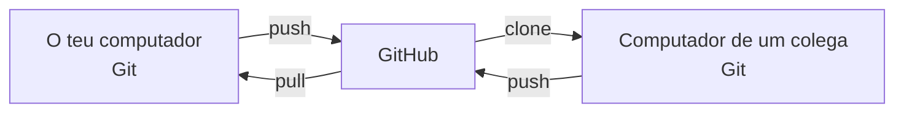

# Módulo 00 · Introdução

## Objetivos

No fim deste módulo consegues:

- Explicar o que é controlo de versões e porque existe.
- Distinguir Git de GitHub.
- Reconhecer os termos básicos: repositório, commit, branch, remoto.

## O problema

Quase toda a gente já teve uma pasta assim:

```text
relatorio.docx
relatorio_v2.docx
relatorio_final.docx
relatorio_final_corrigido.docx
relatorio_final_AGORA_SIM.docx
```

Isto é controlo de versões feito à mão, e tem problemas:

- Não sabes o que mudou entre uma versão e a outra.
- Não sabes porque mudou.
- Se duas pessoas editarem ao mesmo tempo, alguém perde trabalho.
- Voltar atrás é um jogo de adivinhas.

Num projeto de programação com dezenas de ficheiros e várias pessoas, isto torna-se impossível de gerir.

## A solução: controlo de versões

Um **sistema de controlo de versões** regista a história de um projeto. Em vez de copiares ficheiros, guardas "fotografias" do projeto em momentos importantes. Cada fotografia regista:

- **o que** mudou (linha a linha),
- **quem** mudou,
- **quando** mudou,
- **porquê** mudou (uma mensagem escrita por ti).

Com isto podes ver o histórico, comparar versões, voltar atrás e trabalhar em paralelo com outras pessoas sem pisar o trabalho de ninguém.

## Git

O **Git** é o sistema de controlo de versões mais usado no mundo. Foi criado em 2005 por Linus Torvalds, o criador do Linux.

- É um programa que corre **no teu computador**.
- É gratuito e de código aberto.
- Funciona sem internet: o histórico completo fica guardado na tua máquina.

## GitHub

O **GitHub** é um site que aloja repositórios Git **na internet**.

- Serve de cópia de segurança do teu trabalho.
- Permite colaborar com outras pessoas.
- Funciona como portefólio: recrutadores e clientes olham para o teu perfil.

Existem alternativas, como o GitLab e o Bitbucket. Todas usam Git por baixo.

## Git não é GitHub

| | Git | GitHub |
|---|-----|--------|
| O que é | Um programa | Um site / serviço |
| Onde vive | No teu computador | Na internet |
| Para que serve | Registar o histórico do projeto | Guardar, partilhar e colaborar |
| Precisa de internet | Não | Sim |

Uma comparação útil: o Git é a máquina fotográfica, o GitHub é o álbum online onde publicas as fotografias.



## Vocabulário essencial

Vais ver estes termos em todo o curso. Não precisas de os decorar agora.

| Termo | Significado |
|-------|-------------|
| **Repositório** (repo) | A pasta do projeto, com todo o seu histórico |
| **Commit** | Uma "fotografia" do projeto num dado momento |
| **Branch** | Uma linha de trabalho paralela |
| **Merge** | Juntar o trabalho de uma branch noutra |
| **Remoto** (remote) | Uma cópia do repositório noutro sítio, por exemplo no GitHub |
| **Push** | Enviar os teus commits para o remoto |
| **Pull** | Trazer commits do remoto para o teu computador |
| **Clone** | Descarregar uma cópia completa de um repositório |

O [glossário](../../materiais/glossario.md) tem a lista completa.

## Exercícios

1. Explica por palavras tuas, a alguém que não programa, a diferença entre Git e GitHub.
2. Pensa num trabalho (escolar ou profissional) em que perdeste uma versão de um ficheiro. Como é que um histórico de versões teria ajudado?
3. Visita o repositório do Python em <https://github.com/python/cpython>. Encontra o número de commits e o número de contribuidores.

## Quiz

Testa o que aprendeste no [quiz do módulo 00](quiz.md).

## Checklist

- [ ] Sei explicar para que serve o controlo de versões.
- [ ] Sei a diferença entre Git e GitHub.
- [ ] Reconheço os termos repositório, commit e branch.

## Referências

**Português**

- [Pro Git, cap. 1: Começando](https://git-scm.com/book/pt-br/v2/Primeiros-Passos-Sobre-Controle-de-Vers%C3%A3o)
- [GitHub Docs: Sobre o GitHub e o Git](https://docs.github.com/pt/get-started/start-your-journey/about-github-and-git)

**English**

- [Pro Git, ch. 1: Getting Started](https://git-scm.com/book/en/v2/Getting-Started-About-Version-Control)
- [Atlassian: What is version control](https://www.atlassian.com/git/tutorials/what-is-version-control)

---

[Início](../../README.md) · Seguinte: [01 Preparar o ambiente →](../01-preparar-ambiente/README.md)
