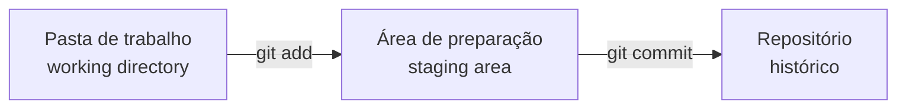

# Módulo 03 · Primeiro repositório

## Objetivos

No fim deste módulo consegues:

- Criar um repositório Git.
- Explicar as três áreas do Git.
- Fazer commits e consultar o histórico.

## Criar o repositório

```bash
cd ~/curso-git
mkdir meu-diario
cd meu-diario
git init
```

O `git init` transforma a pasta num repositório. Confirma com `ls -a`: apareceu uma pasta oculta chamada `.git`. É lá que o Git guarda todo o histórico.

> Nunca edites nem apagues a pasta `.git` à mão. Se a apagares, perdes o histórico todo.

## O comando que mais vais usar

```bash
git status
```

O `git status` diz-te em que estado está o repositório e, muitas vezes, sugere o comando seguinte. Corre-o antes e depois de cada operação até se tornar um reflexo.

## As três áreas

Este é o conceito mais importante do curso.



| Área | O que é |
|------|---------|
| **Pasta de trabalho** | Os ficheiros como os vês e editas |
| **Área de preparação** (staging) | As alterações que escolheste para o próximo commit |
| **Repositório** | Os commits já gravados no histórico |

Pensa numa encomenda: editas os produtos (pasta de trabalho), pões na caixa os que queres enviar (`git add`) e fechas a caixa com uma etiqueta (`git commit`).

A área de preparação existe para escolheres **o que** entra em cada commit. Podes ter alterado cinco ficheiros e querer gravar só dois.

## O primeiro commit

Cria um ficheiro:

```bash
echo "# O meu diário de estudo" > README.md
git status
```

O Git mostra o ficheiro como *untracked*: existe na pasta, mas o Git ainda não o acompanha.

Adiciona-o à área de preparação:

```bash
git add README.md
git status
```

Agora aparece em *Changes to be committed*. Grava o commit:

```bash
git commit -m "Adiciona README inicial"
```

A opção `-m` indica a mensagem. Parabéns, tens o teu primeiro commit.

## O ciclo do dia a dia

```text
editar  →  git status  →  git add  →  git commit
```

Repete o ciclo:

```bash
echo "Dia 1: instalei o Git e fiz o primeiro commit." >> README.md
git status
git add README.md
git commit -m "Regista o primeiro dia de estudo"
```

Repara que no `git status` o ficheiro apareceu como *modified*: o Git já o conhece e detetou a alteração.

### Formas de usar o `git add`

```bash
git add ficheiro.txt        # um ficheiro
git add pasta/              # uma pasta inteira
git add .                   # tudo o que mudou na pasta atual
```

O `git add .` é prático, mas corre sempre `git status` antes, para não incluíres ficheiros por engano.

## Ver o histórico

```bash
git log
```

Cada commit mostra:

- um identificador único (o *hash*, uma sequência como `a1b2c3d...`),
- o autor e a data,
- a mensagem.

Para sair do ecrã do log, carrega em `q`.

Uma versão compacta, muito útil:

```bash
git log --oneline
```

## Um bom commit

- **Pequeno e focado:** uma alteração lógica por commit.
- **Com mensagem clara:** quem ler deve perceber o que mudou sem abrir os ficheiros.

| Evita | Prefere |
|-------|---------|
| `alterações` | `Adiciona lista de tarefas da semana` |
| `fix` | `Corrige data errada no dia 2` |
| `asdfg` | `Remove secção duplicada do README` |

No [módulo 08](../08-boas-praticas/README.md) aprofundamos as mensagens de commit.

## Exercícios

1. Cria `tarefas.txt` com três tarefas e faz um commit.
2. Altera o `README.md` **e** o `tarefas.txt`. Faz dois commits separados, um para cada ficheiro.
3. Cria dois ficheiros novos e adiciona os dois com um único `git add`.
4. Corre `git log --oneline`. Quantos commits tens?
5. Depois de um `git add`, o que diz o `git status` sobre como retirar o ficheiro da área de preparação? (Não precisas de executar. É matéria do próximo módulo.)

## Checklist

- [ ] Sei criar um repositório com `git init`.
- [ ] Sei explicar as três áreas.
- [ ] Uso `git status` antes e depois de cada passo.
- [ ] Fiz pelo menos cinco commits com mensagens claras.

## Referências

**Português**

- [Pro Git: Gravando alterações em seu repositório](https://git-scm.com/book/pt-br/v2/Fundamentos-do-Git-Gravando-Altera%C3%A7%C3%B5es-no-Reposit%C3%B3rio)
- [git: o guia prático](https://rogerdudler.github.io/git-guide/index.pt_BR.html)

**English**

- [Pro Git: Recording Changes to the Repository](https://git-scm.com/book/en/v2/Git-Basics-Recording-Changes-to-the-Repository)
- [Atlassian: Saving changes](https://www.atlassian.com/git/tutorials/saving-changes)

---

[← 02 Terminal básico](../02-terminal-basico/README.md) · [Início](../../README.md) · Seguinte: [04 Histórico e desfazer →](../04-historico-e-desfazer/README.md)
