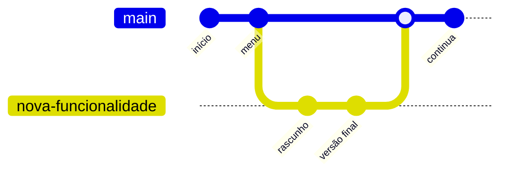

# Módulo 05 · Branches e merge

## Objetivos

No fim deste módulo consegues:

- Criar branches e mudar entre elas.
- Juntar o trabalho de uma branch noutra com `merge`.
- Resolver um conflito de merge sem pânico.

## O que é uma branch

Uma **branch** é uma linha de trabalho independente. Permite-te experimentar, desenvolver uma funcionalidade ou corrigir um erro sem mexer na versão principal do projeto.

A branch principal chama-se `main`. A regra habitual é: **a `main` está sempre a funcionar**. O trabalho novo faz-se noutras branches e só entra na `main` quando está pronto.



Criar uma branch no Git é instantâneo e não duplica ficheiros. Usa-as à vontade.

## Comandos essenciais

```bash
git branch                    # lista as branches (o * marca a atual)
git switch -c nome-da-branch  # cria uma branch e muda para ela
git switch main               # muda para uma branch existente
git branch -d nome-da-branch  # apaga uma branch já integrada
```

> Em tutoriais mais antigos vais ver `git checkout -b nome` e `git checkout main`. Fazem o mesmo. O `git switch` é o comando mais recente e mais claro.

## Mão na massa

No repositório `meu-diario`:

```bash
git switch -c adiciona-objetivos
echo "Objetivo: dominar o Git em 4 semanas" > objetivos.txt
git add objetivos.txt
git commit -m "Adiciona ficheiro de objetivos"
```

Volta à `main` e olha para a pasta:

```bash
git switch main
ls
```

O ficheiro `objetivos.txt` desapareceu. Não foi apagado: existe na outra branch. Ao mudares de branch, o Git altera os ficheiros da pasta para corresponderem a essa branch.

## Merge: juntar o trabalho

Para trazer o trabalho para a `main`:

```bash
git switch main
git merge adiciona-objetivos
```

O merge faz-se sempre **a partir da branch que recebe**. Primeiro vais para a `main`, depois pedes para juntar a outra.

Depois de integrada, a branch pode ser apagada:

```bash
git branch -d adiciona-objetivos
```

### Dois tipos de merge

- **Fast-forward:** a `main` não mudou desde que criaste a branch. O Git limita-se a avançar a `main`. Não cria commit novo.
- **Merge commit:** as duas branches têm commits novos. O Git cria um commit especial que une as duas histórias.

Vê o resultado com:

```bash
git log --oneline --graph --all
```

## Conflitos

Um **conflito** acontece quando duas branches alteraram **as mesmas linhas do mesmo ficheiro**. O Git não sabe qual versão escolher e pede-te para decidir.

Conflitos são normais. Não significam que fizeste algo errado.

### Provocar um conflito de propósito

```bash
# Na main, cria um ficheiro
echo "Cor favorita: azul" > perfil.txt
git add perfil.txt
git commit -m "Adiciona perfil"

# Numa branch, altera a linha
git switch -c muda-cor
echo "Cor favorita: verde" > perfil.txt
git commit -am "Muda cor para verde"

# Na main, altera a mesma linha de outra forma
git switch main
echo "Cor favorita: vermelho" > perfil.txt
git commit -am "Muda cor para vermelho"

# Tenta juntar
git merge muda-cor
```

O Git responde com `CONFLICT` e para a meio do merge.

(A opção `-am` junta o `add` e o `commit` num só passo. Funciona apenas para ficheiros que o Git já acompanha.)

### Resolver

Abre o ficheiro. O Git marcou a zona em conflito:

```text
<<<<<<< HEAD
Cor favorita: vermelho
=======
Cor favorita: verde
>>>>>>> muda-cor
```

- Entre `<<<<<<< HEAD` e `=======` está a versão da branch onde estás (`main`).
- Entre `=======` e `>>>>>>>` está a versão da branch que estás a juntar.

Para resolver:

1. Edita o ficheiro até ficar como queres: uma das versões, a outra, ou uma combinação.
2. **Apaga os marcadores** `<<<<<<<`, `=======` e `>>>>>>>`.
3. Marca como resolvido e conclui:

```bash
git add perfil.txt
git commit
```

O VS Code ajuda: mostra botões como *Accept Current Change* e *Accept Incoming Change* por cima do conflito.

Se quiseres desistir e voltar ao estado anterior ao merge:

```bash
git merge --abort
```

## Boas práticas com branches

- Uma branch por tarefa: `corrige-login`, `adiciona-relatorio-vendas`.
- Nomes curtos, descritivos, em minúsculas e com hífenes.
- Branches curtas: quanto mais tempo vivem, mais conflitos aparecem.
- Apaga as branches depois de integradas.

## Exercícios

1. Cria a branch `adiciona-contactos`, faz dois commits nela e junta-a à `main`.
2. Corre `git log --oneline --graph --all` antes e depois do merge. O que mudou?
3. Repete o exemplo do conflito com um ficheiro e textos teus. Resolve-o combinando as duas versões.
4. Provoca outro conflito e, desta vez, desiste com `git merge --abort`.
5. Tenta apagar com `git branch -d` uma branch que ainda não foi integrada. O que diz o Git?

## Quiz e desafio

- Testa o que aprendeste no [quiz do módulo 05](quiz.md).
- Faz as Etapas 2 e 3 do [Desafio Learn Git Branching](../../desafios/learn-git-branching.md), um jogo no browser onde vês a árvore de commits a mudar a cada comando.
- Joga o ato 2 do [Gitvana](../../desafios/README.md#gitvana), com branches e merges feitos sobre ficheiros verdadeiros.

## Checklist

- [ ] Sei criar, listar, mudar e apagar branches.
- [ ] Sei fazer merge a partir da branch que recebe.
- [ ] Resolvi pelo menos um conflito sozinho.
- [ ] Sei cancelar um merge com `--abort`.

## Referências

**Português**

- [Pro Git: Branches em poucas palavras](https://git-scm.com/book/pt-br/v2/Ramifica%C3%A7%C3%A3o-Branching-no-Git-Branches-em-Poucas-Palavras)
- [Pro Git: O básico de ramificação e mesclagem](https://git-scm.com/book/pt-br/v2/Ramifica%C3%A7%C3%A3o-Branching-no-Git-Ramifica%C3%A7%C3%A3o-Branching-e-Mesclagem-Merging-B%C3%A1sicas)
- [Learn Git Branching (jogo interativo, em português)](https://learngitbranching.js.org/?locale=pt_BR)

**English**

- [Pro Git: Basic Branching and Merging](https://git-scm.com/book/en/v2/Git-Branching-Basic-Branching-and-Merging)
- [Atlassian: Git merge conflicts](https://www.atlassian.com/git/tutorials/using-branches/merge-conflicts)

---

[← 04 Histórico e desfazer](../04-historico-e-desfazer/README.md) · [Início](../../README.md) · Seguinte: [06 GitHub e repositórios remotos →](../06-github-remotos/README.md)
