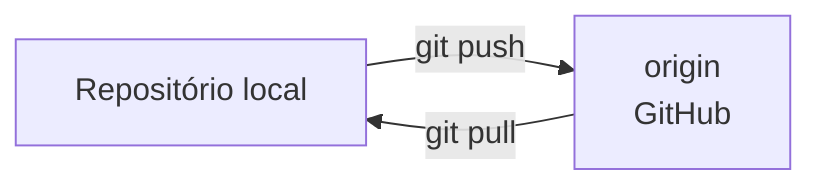

# Módulo 06 · GitHub e repositórios remotos

## Objetivos

No fim deste módulo consegues:

- Publicar um repositório local no GitHub.
- Enviar e receber commits com `push` e `pull`.
- Clonar um repositório existente.
- Autenticar-te no GitHub a partir do terminal.

## O que é um remoto

Um **remoto** é uma cópia do repositório alojada noutro sítio, normalmente no GitHub. Até agora, tudo o que fizeste vive apenas no teu computador. Com um remoto ganhas uma cópia de segurança e a possibilidade de colaborar.

Por convenção, o remoto principal chama-se `origin`.



## Publicar um repositório local

### 1. Criar o repositório no GitHub

1. Em <https://github.com/new>, escolhe um nome (por exemplo `meu-diario`).
2. Escolhe **Public** ou **Private**.
3. **Não** marques *Add a README*, `.gitignore` nem licença. O teu repositório local já tem conteúdo, e um repositório remoto vazio evita conflitos.
4. Clica em *Create repository*.

### 2. Ligar o local ao remoto

No terminal, dentro do teu repositório:

```bash
git remote add origin https://github.com/O-TEU-UTILIZADOR/meu-diario.git
git remote -v
```

O `git remote -v` mostra os remotos configurados.

### 3. Enviar

```bash
git push -u origin main
```

O `-u` liga a tua `main` local à `main` do `origin`. Só é preciso na primeira vez. A partir daí basta `git push`.

Atualiza a página do repositório no GitHub: os teus ficheiros e commits estão lá.

## Autenticação

O GitHub **não aceita a palavra-passe da conta** em operações Git. Tens duas opções.

### HTTPS (o mais simples para começar)

- **Windows:** o Git inclui o *Git Credential Manager*. No primeiro `push` abre-se uma janela do browser para entrares no GitHub. Depois disso fica guardado.
- **macOS / Linux:** instala o [GitHub CLI](https://cli.github.com) e corre `gh auth login`, ou cria um *personal access token* em *Settings → Developer settings → Personal access tokens* e usa-o no lugar da palavra-passe.

### SSH (recomendado a longo prazo)

Com SSH, o teu computador identifica-se com um par de chaves e nunca mais te pede credenciais.

```bash
# 1. Gerar o par de chaves (aceita o caminho sugerido)
ssh-keygen -t ed25519 -C "o-teu-email@exemplo.com"

# 2. Mostrar a chave PÚBLICA para copiar
cat ~/.ssh/id_ed25519.pub
```

3. No GitHub: *Settings → SSH and GPG keys → New SSH key*. Cola a chave pública.
4. Testa:

```bash
ssh -T git@github.com
```

Com SSH, o endereço do remoto tem outro formato: `git@github.com:O-TEU-UTILIZADOR/meu-diario.git`.

> A chave **privada** (`id_ed25519`, sem `.pub`) nunca sai do teu computador. Nunca a partilhes nem a ponhas num repositório.

## O ciclo com remoto

```text
git pull  →  editar  →  git add  →  git commit  →  git push
```

```bash
git pull     # traz e integra as novidades do remoto
git push     # envia os teus commits
```

Faz `git pull` antes de começares a trabalhar, sobretudo quando trabalhas em equipa ou em mais do que um computador.

### `fetch` e `pull`

```bash
git fetch    # descarrega as novidades, mas não mexe nos teus ficheiros
git pull     # fetch + merge: descarrega e integra
```

O `fetch` é seguro: permite ver o que há de novo antes de integrar. Depois de um `fetch`, o `git status` diz-te se estás atrás ou à frente do remoto.

### Push rejeitado

Se o remoto tiver commits que tu não tens, o `git push` é rejeitado. A solução é integrar primeiro:

```bash
git pull
# resolve conflitos, se houver
git push
```

> Vais encontrar na internet o conselho de usar `git push --force`. Não o faças numa branch partilhada: apaga os commits dos teus colegas.

## Clonar um repositório

Para obter uma cópia de um repositório que já existe no GitHub:

```bash
git clone https://github.com/UTILIZADOR/REPOSITORIO.git
cd REPOSITORIO
```

O `clone` descarrega o histórico completo e já configura o `origin`. Não precisas de `git init` nem de `git remote add`.

## Branches no remoto

```bash
git push -u origin nome-da-branch    # publica uma branch nova
git branch -a                        # lista branches locais e remotas
git push origin --delete nome        # apaga uma branch no remoto
```

## Exercícios

1. Publica o teu repositório `meu-diario` no GitHub.
2. Faz um commit novo no teu computador e envia-o. Confirma no site.
3. No GitHub, edita o `README.md` pelo site (ícone do lápis) e grava. Depois faz `git pull` no teu computador e confirma com `git log`.
4. Clona o teu próprio repositório para outra pasta (`git clone <url> copia-diario`). Faz um commit na cópia, envia-o e traz essa alteração para a pasta original.
5. Cria uma branch local, publica-a no GitHub e encontra-a no site.
6. Configura a autenticação por SSH e muda o endereço do remoto com `git remote set-url origin git@github.com:UTILIZADOR/meu-diario.git`.

## Checklist

- [ ] O meu repositório está no GitHub.
- [ ] Consigo fazer `push` e `pull` sem erros de autenticação.
- [ ] Sei a diferença entre `fetch` e `pull`.
- [ ] Sei clonar um repositório.

## Referências

**Português**

- [Pro Git: Trabalhando de forma remota](https://git-scm.com/book/pt-br/v2/Fundamentos-do-Git-Trabalhando-com-Reposit%C3%B3rios-Remotos)
- [GitHub Docs: Conectar ao GitHub com SSH](https://docs.github.com/pt/authentication/connecting-to-github-with-ssh)
- [GitHub Docs: Sobre repositórios remotos](https://docs.github.com/pt/get-started/git-basics/about-remote-repositories)

**English**

- [Pro Git: Working with Remotes](https://git-scm.com/book/en/v2/Git-Basics-Working-with-Remotes)
- [GitHub Docs: Connecting to GitHub with SSH](https://docs.github.com/en/authentication/connecting-to-github-with-ssh)
- [Atlassian: Syncing](https://www.atlassian.com/git/tutorials/syncing)

---

[← 05 Branches e merge](../05-branches-e-merge/README.md) · [Início](../../README.md) · Seguinte: [07 Colaboração →](../07-colaboracao/README.md)
