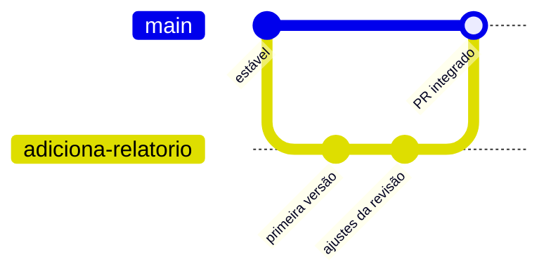
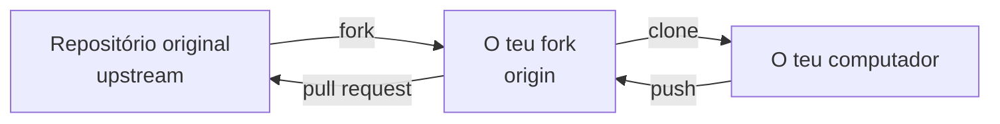

# Módulo 07 · Colaboração

## Objetivos

No fim deste módulo consegues:

- Seguir o GitHub Flow.
- Abrir, rever e integrar um pull request.
- Usar issues para organizar trabalho.
- Contribuir para um projeto de outra pessoa através de um fork.

## GitHub Flow

O **GitHub Flow** é a forma de trabalho mais comum em equipas. É simples:

1. A `main` está sempre estável.
2. Para cada tarefa, cria-se uma branch a partir da `main`.
3. Fazem-se commits nessa branch e envia-se para o GitHub.
4. Abre-se um **pull request** (PR).
5. A equipa revê e comenta.
6. Aprovado, o PR é integrado na `main` e a branch é apagada.



## Pull request

Um **pull request** é um pedido para integrar a tua branch noutra (normalmente a `main`). É também o sítio onde a equipa discute e revê as alterações antes de entrarem.

### Abrir um PR

```bash
git switch main
git pull
git switch -c melhora-readme

# ... edita, add, commit ...

git push -u origin melhora-readme
```

Depois, no GitHub:

1. Aparece um aviso *Compare & pull request*. Clica nele.
2. Escreve um título claro e uma descrição: **o que** mudou e **porquê**.
3. Clica em *Create pull request*.

Uma boa descrição de PR responde a três perguntas:

```markdown
## O que muda
Adiciona a secção "Como instalar" ao README.

## Porquê
Quem chegava ao repositório não sabia como começar.

## Como testar
Seguir os passos da secção num computador sem o projeto instalado.
```

### Rever um PR

No separador *Files changed* podes:

- comentar linhas específicas,
- sugerir alterações,
- aprovar (*Approve*) ou pedir mudanças (*Request changes*).

Rever código é uma competência. Comenta o código, não a pessoa. Pergunta em vez de ordenar ("o que achas de...?"). Elogia o que está bem feito.

Para responder à revisão, basta fazer mais commits na mesma branch e `git push`. O PR atualiza-se sozinho.

### Integrar

Aprovado o PR, clica em *Merge pull request* e apaga a branch. No teu computador:

```bash
git switch main
git pull
git branch -d melhora-readme
```

## Issues

As **issues** são o sistema de tarefas do GitHub. Servem para registar erros, ideias e trabalho por fazer.

Uma boa issue de erro inclui:

- o que esperavas que acontecesse,
- o que aconteceu,
- os passos para reproduzir.

Para ligar um PR a uma issue, escreve na descrição do PR `Closes #12` (com o número da issue). Quando o PR for integrado, a issue fecha automaticamente.

## Fork: contribuir para projetos de outros

Não tens permissão para fazer `push` em repositórios de outras pessoas. A solução é o **fork**: uma cópia do repositório na tua conta.



Passo a passo:

1. No repositório original, clica em **Fork**.
2. Clona **o teu fork**:

```bash
git clone https://github.com/O-TEU-UTILIZADOR/projeto.git
cd projeto
```

3. Cria uma branch, faz as alterações, commit e push (para o teu fork).
4. No GitHub, abre um pull request do teu fork para o repositório original.

### Manter o fork atualizado

O original continua a evoluir. Para acompanhar, adiciona-o como segundo remoto, por convenção chamado `upstream`:

```bash
git remote add upstream https://github.com/DONO-ORIGINAL/projeto.git
git fetch upstream
git switch main
git merge upstream/main
git push
```

## Trabalhar no mesmo repositório

Numa equipa, o dono do repositório pode adicionar colaboradores em *Settings → Collaborators*. Os colaboradores fazem `push` de branches diretamente, sem fork, e abrem PRs dentro do mesmo repositório.

Recomenda-se proteger a `main` (*Settings → Branches*) para obrigar a que todas as alterações passem por um PR.

## Exercícios

1. No teu repositório `meu-diario`, cria uma issue chamada "Adicionar secção de recursos".
2. Resolve essa issue numa branch, abre um PR com `Closes #1` na descrição e integra-o. Confirma que a issue fechou.
3. Em pares: adiciona um colega como colaborador. Cada um abre um PR, e o outro revê com pelo menos um comentário antes de aprovar.
4. Faz fork do repositório [first-contributions](https://github.com/firstcontributions/first-contributions) e segue as instruções para o teu primeiro PR num projeto público.
5. Faz fork deste curso, corrige uma gralha ou melhora uma explicação, e abre um PR.

## Quiz e prática guiada

- Testa o que aprendeste no [quiz do módulo 07](quiz.md).
- Faz os cursos *Introduction to GitHub*, *Review pull requests* e *Resolve merge conflicts* do [GitHub Skills](../../desafios/README.md#github-skills), onde um robô te dá tarefas na tua própria conta.

## Checklist

- [ ] Sei descrever os passos do GitHub Flow.
- [ ] Abri e integrei um pull request.
- [ ] Revi o PR de outra pessoa.
- [ ] Sei a diferença entre `origin` e `upstream`.

## Referências

**Português**

- [GitHub Docs: Fluxo do GitHub](https://docs.github.com/pt/get-started/using-github/github-flow)
- [GitHub Docs: Sobre pull requests](https://docs.github.com/pt/pull-requests/collaborating-with-pull-requests/proposing-changes-to-your-work-with-pull-requests/about-pull-requests)
- [GitHub Docs: Contribuir para um projeto](https://docs.github.com/pt/get-started/exploring-projects-on-github/contributing-to-a-project)
- [first-contributions (instruções em português)](https://github.com/firstcontributions/first-contributions/blob/main/docs/translations/README.pt_br.md)

**English**

- [GitHub Docs: GitHub flow](https://docs.github.com/en/get-started/using-github/github-flow)
- [GitHub Skills: Introduction to GitHub](https://github.com/skills/introduction-to-github)
- [Pro Git: Contributing to a Project](https://git-scm.com/book/en/v2/GitHub-Contributing-to-a-Project)

---

[← 06 GitHub e repositórios remotos](../06-github-remotos/README.md) · [Início](../../README.md) · Seguinte: [08 Boas práticas →](../08-boas-praticas/README.md)
